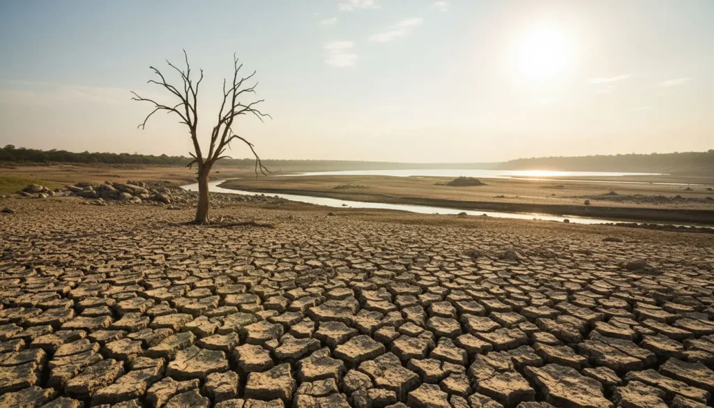
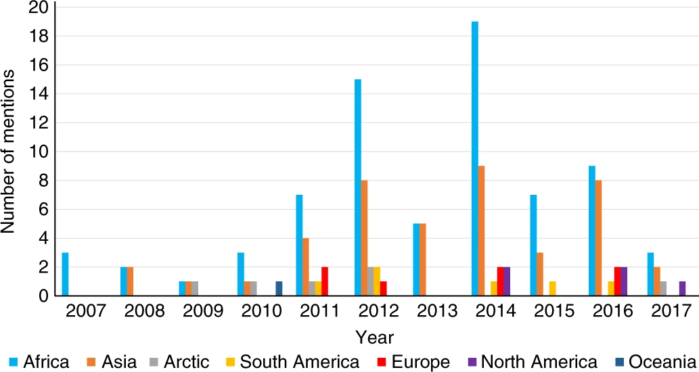

# Climate change and conflict

Climate change affects those living and non-living across the globe without discrimination, impacting those who contribute the least. With the increase in natural disasters, scientists have been attempting to find a connection between climate change and violent conflict that arise from impacted resources and the inability to access basic essentials (Bowles et al., 2015). A study by Adams et al. (2018) states the biases that occur within these studies are overexaggerating the link between the two.

For a few years, scientists have been studying whether socioeconomic pressure from natural events due to climate change can create conflict and push communities to enact violence out of a neccesity to survive, but there is a bias from before data collection.

The figure above shows the continents that are mentioned the most when researching for communities that may have conflict due to climate change. As it shows, the continent of Africa is mentioned the most with South America being second. 

A study based on Syria leading into its civil war crisis written by Bowles et al. (2015) when focusing on a drought that impacted the people with severe food insecurity. Syria, a country known for its political instability, was plagued by a drought from 2007 to 2010 that caused crop failures, decreased agricultural production across regions, as well as the cessation of government subsidies. This left about 1.5 million people, including refugees from Iraq, battling food insecurity. Discontent spread like fire, creating a ground for uprising, as the government remained incapable of providing relief to the people impacted by poverty. The timing of this coincides with the Syrian civil war occurring in 2011.
The limitation for this paper was the fact that only Syria was studied even though the same drought impacted both Jordan and Lebanon. This is important for a true analysis on these connections which was mentioned in the article by Adams et al. (2018). There was little analysis on the two countries experiencing the same drought and the main question then transitions to studying whether the research claiming the connection between climate change and conflict was based on a sampling bias strategy. This question was conducted by scanning databases, searching articles based on geographic regions, economic levels, as well as agricultural contribution to GDP. A statistical analysis was also done to conclude that there was a sampling bias (Adams et al., 2018).

Adams et al. (2018) found that countries experiencing more than 1,000 battle-related deaths were mentioned about three times more in topics surrounding climate–conflict research compared to countries with fewer battle-related deaths. This can exaggerate the connection between the climate change and violent conflict which significantly impacts both scientific communities due to incomplete information as well as the harm vulnerable communities that are in need for public awareness and assistance. These studies such as the ones focusing on data with keywords using “conflict” to find published articles, can overemphasize the connection. 

Beyond the incomplete representation, this can lead to stigmatization, such as people viewing some places as being more naturally violent than others. This stigmatization can hurt the appeal for investors or local people and international donors which can harm sustainable development. Therefore, leaving out areas without conflict can create a gap in knowledge on how people adapt to climate concerns and the impacts of it peacefully, which can be valuable for those in policymaking (Adams et al., 2018). These biases stemmed from scientists focusing on a few accessible regions, that were known for political instability, thus overstating the link between climate change and violent conflict.

# Limitations and Solutions

Discussing the connection between climate change and conflict, there is weight behind a scientitfic community as the studies can impact the community through enganging with those involved in politics that are capable of responding or aiding the affected communities.

- *Sampling bias:**  selecting study groups that can prevent meaningful comparisons, in this case only selecting regions experiencing the same drought under different socio-political and economic situations, whether there is a conflict present or not (Konno et al. 2024).

- **Streetlight Effect:** a convenience bias where researchers study the places that are easiest to reach than ones with meaningful comparision. (Adams et al. 2018)

 A solution for the study from Bowles et al. (2015) would be to compare countries experiencing the drought from 2007 to 2010, regardless of the conflict present as the question is to discover if there is a connection between the two variables: climate change and conflict. 
 
 This could be studied like an elementary experiment with a control group to reference rather than having no other comparisons.
For this study to truly analyze whether there is a link between climate change and conflict, there must be more studies on those experiencing similar or other climate impacts, without the stress of conflict since this would create a predictable outcome or misinterpret the connection almost by force. This would be classified as a coverage bias since there is not a full representation of those impacted by a drought, using the example from the analysis on Syria.

Beyond the sampling or selection bias, there are further limitations that make explaining an event complex as it is entangled with numerous variables. There can be the inability to conduct long period studies to truly visualize climate impacting a region and its influence on conflict, as well as difference between countries, its political, economic, and sociological factors, and lastly, the environmental pressures communities face may differ from one another (Buhaug, 2015). The simplification that climate change causes conflicts to be overlooked and ignores variables that interact with each other to create complex situations. 

# A Way forward for an equitable future

The study on climate and conflict shouldn’t be tossed out completely, but the analysis from the example done in Syria should disclose that the focus was only on areas known for war and that further study needs to be done for an accurate representation to find a true connection between the two variables.

If further study is done besides a literature review, researchers may be able to establish themselves within the communities they are focusing on to get a clearer representation on the people impacted. 

Bias isn’t the only concern, but with studies done in the region of focus, another ethical concern can occur which is helicopter science. The study can be about health and assisting those impacted by climate change, but the people within the study group can take notes then leave and never report back as read from the assigned reading when discussing environmental data justice during week 7 (Vera et al., 2019). A way forward is to replace the helicopter science, or extractive science, with practices that are community-based, which can be a collaborative practice of utilizing other’s knowledge and prioritizing their interests rather than what is thought to be important from an outside perspective.
Thus, a zombie apocalypse in movies can magnify the entertainment factor to gain appeal for box-office records, but scientists should stick to representing accurate information to aid community members that are facing real-life horror while representing their needs with ethical consideration. 

## References

Adams, C., Ide, T., Barnett, J., & Detges, A. (2018). Sampling bias in climate–conflict research. Nature Climate Change, 8, 200–203.[available here](https://doi.org/10.1038/s41558-018-0068-2)

Bowles, D. C., Butler, C. D., & Morisetti, N. (2015). Climate change, conflict and health. Journal of the Royal Society of Medicine, 108(10), 390–395. [available here](https://doi.org/10.1177/0141076815603234)

Buhaug, H. (2015). Climate–conflict research: Some reflections on the way forward. WIREs Climate Change, 6, 269–275. [available here](https://doi.org/10.1002/wcc.336)

Konno, K., Gibbons, J., Lewis, R., & Pullin, A. S. (2024). Potential types of bias when estimating causal effects in environmental research and how to interpret them. Environmental Evidence, 13, Article 1. [available here](https://doi.org/10.1186/s13750-024-00324-7)

Vera, L. A., Walker, D., Murphy, M., Mansfield, B., Mohamed Siad, L., Ogden, J., & EDGI. (2019). When data justice and environmental justice meet: Formulating a response to extractive logic through environmental data justice. Information, Communication & Society, 22(7), 1012–1028. [available here](https://doi.org/10.1080/1369118X.2019.1596293)
