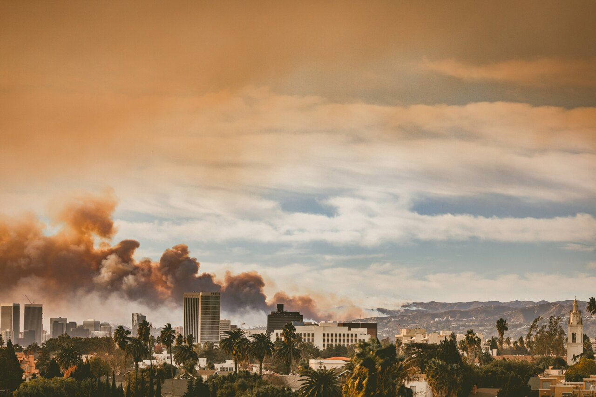

This project is divided into two sections:

1. A true and false color image of the Palisades and Eaton fire from January 2025.
2. A social dimensions analysis mapping vulnerable communities affected by the fires using the Environmental Justice Index.

Additional information can be found at my [GitHub repository](https://github.com/moniqueallyson/eds220-hwk4.git).

# Part 1: Visualizing true and false color image of Palisades and Eaton Fire

## About
### Purpose

This analysis explores the environmental impact caused by the fires in Palisades and Eaton that occurred on January 7, 2025 in Los Angeles County (LA). A false color image is created using the fire perimeters dataset and remote sensing techniques to depict the affected areas in contrast to those left untouched by the fires. The true color image shows the LA area, but it is hard to recognize the fire scars which is why assigning infrared to visible light in order to create a false color image highlights healthy vegetation, burn severity, and extent of fire scars. This can then help researchers plan restoration strategies and identify high-risk areas for future planning and reduce the environmental, economic, and personal damages cities face in the aftermath. Though communities are impacted disproportionately with some incapable of evacuating, recovering, and even rebuilding. The Environmental Justice Index will be used to measure the impacts of the fire on those who face socially vulnerable and less resilient.

### Highlights

- Retreived CRS using the correct column, `spatial_ref.crs_wkt`.
- Filling in `NaN` values with 0 for bands using RGB (visible light).
- Short-wave infrared, near-infrared, and red for a false color image of fire.
- Using `EJI` to cross-reference environmental burdens from the fires.


### Data

The libraries used are the following:

- Pandas: python library
- Geopandas: extension of pandas for geospatial data
- Rioxarray: read in NC file
- Matplotlib.pyplot: for nice plots
- Contextily: retrieve tile maps

```{python}
#| label: library 
# Import libraries
import pandas as pd
import os
import numpy as np
import geopandas as gpd
import xarray as xr
import rioxarray
import matplotlib.pyplot as plt
import contextily as ctx
```


The three major datasets for this analysis:

**Landsat 8 satellite:**

The first data set, collected by Landsat 8 satellite, is used for its collection of bands (red, green, blue, near-infrared and short-wave infrared), which is from the Landsat Collection 2 Level-2 atmospherically corrected surface reflectance data.

-  The data can be retrieved from [Microsoft Planetary Computer data catalog](https://planetarycomputer.microsoft.com/dataset/landsat-c2-l2).
- For this project the data was given by the instructor and clipped to the surrounding areas for the fire perimeters of both Palisades and Eaton.
- The landsat data is filed under the date it was acquired, February 23, 2025.

**Palisades and Eaton Fire Perimeter:**

The second dataset includes both the fire perimeters for Palisades and Eaton.

- The data was retrieved from [ArcGIS](https://hub.arcgis.com/maps/ad51845ea5fb4eb483bc2a7c38b2370c/about).
- For this analysis, the geometry for the boundary information is needed for the perimeters.

**Environmental Justice Index:**

The 2024 Environmental Justice Index produced by the Centers of Disease Control and PRevention (CDC) and Agency for Toxic Substances and Disease Registry (ASTDR). It is a place-based tool that  measures the impacts of environmental burden focusing on human health and equity. 

- It can be retrieved here on the [CDC website](https://www.atsdr.cdc.gov/place-health/php/eji/index.html)
- The EJ Index has three core modules: Social vulnerability, Environmental burden, and Health vulnerability.
- Includes an EJ Index dictionary with the column names and their descriptions.

```{python}
#| label: import data
#| output: false
# Fire perimeter data
fp = os.path.join(
    'data', 'Eaton_Perimeter_20250121',
    'Eaton_Perimeter_20250121.shp')
eaton = gpd.read_file(fp)

fp = os.path.join(
    'data', 'Palisades_Perimieter_20250121',
    'Palisades_Perimieter_20250121.shp')
palisades = gpd.read_file(fp)

# Read Landsat
landsat = xr.open_dataset('data/landsat8-2025-02-23-palisades-eaton.nc')
landsat

# Read census data and dictionary
fp = os.path.join('data', 'EJI_2024_California', 'EJI_2024_California.gdb')
census = gpd.read_file(fp)

eji_dictionary = pd.read_csv('data/EJI_2024_California/EJI_DATADICTIONARY_2024.csv',
                             skiprows=1,
                             encoding='cp1252')
```

## Further readings

Readings for color images and Landsat imagery:

- [NASA Earth Observatory - Why is that Forest Red and that Cloud Blue? How to Interpret a False-Color Satellite Image](https://science.nasa.gov/earth/earth-observatory/how-to-interpret-a-false-color-satellite-image/)

- [What are the band designations for the Landsat satellites?](https://www.usgs.gov/faqs/what-are-band-designations-landsat-satellites)

- [Common Landsat Band Combinations](https://www.usgs.gov/media/images/common-landsat-band-combinations)

# Method
## Explore fire perimeter data

After the data is imported, an exploration can be conducted using a few methods:

- `.info()`
- `.head()`
- `.shape()`

The data was explored using `.head()` as this gives shape, the column with their names and values. Though, using `.info` can get the same information as well as the `d.types`.

```{python}
# Display row for df
eaton.head()
```
```{python}
# Display row for df
palisades.head()
```

**Visualization for both perimeters**

Use `.plot()` to get a preliminary view on both the fire perimeters.

```{python}
fig, (ax1, ax2) = plt.subplots(1, 2, figsize=(7,7))

# Remove the axis for a cleaner map
ax1.axis('off')
ax2.axis('off')

# Plot Eaton
eaton.plot(ax=ax1, color="cornflowerblue", linewidth=2.5, edgecolor="navy")
ax1.set_title('Eaton Perimeter',
             fontsize=14, weight='bold', pad=15)

# Plot Palisades
palisades.plot(ax=ax2, color="cornflowerblue", linewidth=2.5, edgecolor="gold")
ax2.set_title('Palisades Perimeter',
             fontsize=14, weight='bold', pad=15)
plt.tight_layout()
plt.show()
```

### Exploration summary on perimeter data

- CRS for both Palisades and Eaton is EPSG:4269.
- Both are geographic.
- Both will need to be reprojected in order to match the CRS of Landsat.
- Columns include location and geomerty, discovered using `.head()`.

```{python}
#| output: false
# Explore CRS for both Palisades and Eaton
print(f"Palisades' CRS: {palisades.crs}")
print(f"Eaton's CRS: {eaton.crs}")

# Explore geographic or projected for Eaton 
print('Is Eaton geographic?: ', eaton.crs.is_geographic)
print('Is Eaton projected?: ', eaton.crs.is_projected)

# Explore geographic or projected for Palisades 
print('Is Palisades geographic?: ', palisades.crs.is_geographic)
print('Is Palisades projected?: ', palisades.crs.is_projected)
```

## Exploring Landsat data

Here the data, `landsat`, is being called to show the corresponding information.

```{python}
landsat
```

### Exploration summary on Landsat data
The following five spectral bands are grouped: 

1. Visible light: `red`, `green`, and `blue`. 
2. Near-infrared, `nir08`, discerns land-water boundaries that are not obvious in visible light and shows vegetation health due to the strong reflection which is the key point here. 
3. Short-wave infrared, `swir22`, helps scientists estimate water presence in plants and soil which is helpful for mapping fire damage as more water means darker images.

Other key aspects:

- `spatial_ref` is the last variable and doesn't belong to a spectral band.
- The dimensions are (y:1418, x: 2742).
- The coordinates show y, x, (in meters).
- Temporal extent is February 23, 2025, two weeks after both fires.

### Restoring geospatial information

Landsat dataset is not a geosptatial object and will not have a CRS as shown in a verification check.

```{python}
#| label: landsat crs
#| warning: false
# Find CRS for landsat
print(landsat.rio.crs)
```

Using `rio.write_crs()`, the geospatial information found under `spatial_ref.crs_wkt` was found to be 32611.

```{python}
#| label: crs from spatial ref
#| output: false
# Print CRS of landsat from variable spatial_ref
print(landsat.spatial_ref.crs_wkt)
landsat_crs = landsat.spatial_ref.crs_wkt

# Recover CRS
landsat = landsat.rio.write_crs(landsat_crs)
```

## True color image

A few adjustments were needed to be done before the final true color image of the burned areas for Palisades and Eaton.

Two warnings had to be addressed for a correct True Image:

1.  **Clipping Warning:** "Clipping input data to the valid range for imshow with RGB data (\[0..1\] for floats or \[0..255\] for integers)." This was addressed by using `robust=True`, which adjusts the scale used for plotting to get inside the range for `imshow`.

2.  **RuntimeWarning:** "invalid value encountered in cast xx = (xx \* 255).astype(np.uint8)" After accounting for `NaN` resolved the warning since those values were missing and incapable of being converted into integers when mapped, which came from the bands, `green` and `blue`.

A `for` loop was created to find the missing values `NaN` inside each band, then replaced with 0.
```{python}
#| output: false
# Identify NaN values
bands = ['red', 'green', 'blue', 'nir08', 'swir22']

for band in bands:
    count_nan = np.isnan(landsat[band]).sum().values
    print(f"{band} has {count_nan} NaN")

# Replace NaN values in Landsat with 0
landsat = landsat.fillna(0)
```

The true image created depict LA from satelite view showing the burned areas, shown as reddish-brown.
```{python}
# Ceate image 
fig, ax = plt.subplots(figsize=(8, 6))
ax.axis('off')

landsat[['red', 'green', 'blue']].to_dataarray().plot.imshow(ax=ax,
                                                            robust=True)

ax.set_title('True Color Image Palisades and Eaton Fire Scars', 
             fontsize=15, 
             weight='bold', 
             pad=15
             )
plt.tight_layout()
plt.show()
```

## False color

Both perimeters were re-projected to the landsat data. Now, the perimeters can be included into the satelite map.

```{python}
#| warning: false
# Reproject perimeters to match landsat CRS
eaton = eaton.to_crs(landsat.rio.crs)
palisades = palisades.to_crs(landsat.rio.crs)

# Check CRS match with assert
assert eaton.crs == landsat.rio.crs
assert palisades.crs == landsat.rio.crs
```


For this false color image, the spectral bands used are the following in the exact order:

- `swir22`
- `nir08`
- `red`

The following were incoporated to create the map:

- Use the method `.to_dataarray().plot.imshow()` to create an RGB image with the data.
- Use a `for` loop to place the proper names of the perimeters using their geometry and 

```{python}
# False Color Map
fig, ax = plt.subplots(figsize=(8, 6))

# Remove axis
ax.axis('off')

# Plot false color image
landsat[['swir22', 'nir08', 'red']].to_dataarray().plot.imshow(
    ax=ax, robust=True)

# Plot fire perimeter polygons on top of the image
eaton.boundary.plot(ax=ax,
                    color="navy",
                      linewidth=1, label="Eaton Fire Perimeter")
palisades.boundary.plot(ax=ax,
                         color="gold",
                           linewidth=1, label="Palisades Fire Perimeter")

# Add fire names as text annotations
for fire, name in [(eaton, 'Eaton'), (palisades, 'Palisades')]:
    center = fire.geometry.centroid.iloc[0]
    ax.text(center.x, center.y + 5500, name, fontsize=8,
             ha='center', weight='bold', bbox=dict(
                 boxstyle='round,pad=0.3',
                facecolor='white',
                edgecolor='black', alpha=0.8)
)

# Add labels
ax.set_title('Eaton and Palisades Fire Scars via False Color Image', 
             fontsize=15, 
             weight='bold', 
             pad=15
             )
# Add source
fig.text(
    0.99,
    0.01,
    "Data Source: Landsat (USGS, via Microsoft Planetary Computer); \n"
         "Palisades and Eaton Dissolved Fire Perimeters (County of Los Angeles, via ArcGIS Hub) 2025.",
    ha="right",
    va="bottom",
    fontsize=9,
    color="gray",
    style="italic",
)

ax.ticklabel_format(style='plain', useOffset=False)
plt.tight_layout()
plt.show()
```


# Part 2: Environmental Justice Index and LA Wildfires

## Exploring EJ Index and set-up

The EJ Index comes with a dictionary describing the variables with the inital letter corresponding with their measurements:

- E_: estimates. For example, E_NOINT is the percentage of persons without internet in the census tract.
- EPL_: percentile ranks of those estimates, from 0 to 1.
- SPL_: summed ranks for domains, modules or the overall score.
- RPL_: percentile ranks for domains, modules or the overall score, from 0 to 1.

The technical documentation for EJI has defined SVM as Social Vulnerability Module, through the dictionary `.loc()` can be used to select from the `MODULE` column that will show us the variables plus their description.

```{python}
eji_dictionary.head()
```

```{python}
# Selecting column 2024 variable name and removin trailing characters
eji_dictionary['2024 VARIABLE NAME'] = eji_dictionary['2024 VARIABLE NAME'].str.strip()

# Locate and display 8 of the module from the dictionary showing the desciption and domain
pd.set_option("display.precision", 8)
eji_dictionary.loc[eji_dictionary['MODULE'] == 'SVM', ['2024 VARIABLE NAME', '2024 VARIABLE DESCRIPTION', 'DOMAIN']]
```

The EJI data can be explored using `.head()`.

```{python}
# Explore census
census.head()
```
There can be a detailed exploration for the dataset's `CRS`.
```{python}
#| output: false
# Check the data type of the census dataframe 
print(type(census))

# Check the data type of the geometry column
print(type(census.geometry))

# Check CRS
census.crs

# Examine CRS details
print('Ellipsoid: ', census.crs.ellipsoid)
print('Datum: ', census.crs.datum)
print('Is geographic?: ', census.crs.is_geographic)
print('Is projected?: ', census.crs.is_projected)
```

### Summary of EJI data

The EJI  details are the following:

 - The EJI is a `GeoDataFame` and `GeoSeries`.
 - Has a shape of 5 x 174 columns.
 - It is not Geographic, it is Projected.
 - Datum:  North American Datum 1983
 - CRS: ESRI:102003.

## Spatially join the EJI with perimeter

The goal for this social dimensions analysis is to visualize which communities from Palisades and Eaton were impacted by the fires. Before a map can be generate the CRS from all datasets need to match usin `.to_crs()`.

```{python}
p_census = census.to_crs(palisades.crs)
```

Now, the two datasets can be spatially joined using `gpd.sjoin`.

```{python}
pali_join = gpd.sjoin(p_census, palisades, how='inner', predicate='intersects')
```

Repeat for Eaton fire perimeter.
```{python}
eaton_join = gpd.sjoin(p_census, eaton, how='inner', predicate='intersects')
```

## Clipping to fire perimeters

Clip the EJI data using the palisades perimeter to remove anything outside the intersection of the two using `geopandas.clip`.

```{python}
# Clip Palisades
palisades_census = gpd.clip(pali_join, palisades)
```

Repeat for Eaton fire perimeter
```{python}
# Clip Eaton 
eaton_census = gpd.clip(eaton_join, eaton)
```

```{python}
# Ezplore one of the datasets
eaton_census.head()
```

## Visualize the area of Palisade and Eaton with EJI
Visualize both perimeters:

```{python}
# Have both perimeters be shown side by side
fig, (ax1, ax2) = plt.subplots(1, 2, figsize=(7,7))

# Remove individual axis
ax1.axis('off')
ax2.axis('off')

# Plot Eaton and Palisades on different axis
eaton_census.plot(ax=ax1, color = 'none', linewidth=1.5)
palisades_census.plot(ax=ax2, color = 'none', linewidth=1.5)

# Basemap add
ctx.add_basemap(ax1, crs=eaton.crs, source=ctx.providers.OpenTopoMap)
ctx.add_basemap(ax2, crs=palisades.crs, source=ctx.providers.OpenTopoMap)
# Add title to identify perimeters
ax1.set_title('Eaton Perimeter',
             fontsize=14, weight='bold', pad=15)
ax2.set_title('Palisades Perimeter',
             fontsize=14, weight='bold', pad=15)
plt.tight_layout()
plt.show()
```

The following code is a preliminary check for both fire perimeters intersecting with the EJI and the column `TRACTCE` returning a colored map coordinating with every county code.
```{python}
#| include: false
# Have both perimeters be shown side by side
fig, (ax1, ax2) = plt.subplots(1, 2, figsize=(7,7))

# Remove individual axis
ax1.axis('off')
ax2.axis('off')

# Plot Eaton
eaton_census.plot(ax=ax1, column = 'TRACTCE', cmap = 'magma', legend = True)
ax1.set_title('Eaton Perimeter',
             fontsize=14, weight='bold', pad=15)

# Plot Palisades
palisades_census.plot(ax=ax2, column= 'TRACTCE', cmap = 'magma', legend = True)
ax2.set_title('Palisades Perimeter',
             fontsize=14, weight='bold', pad=15)
```

## Visualize an EJI variable

Examine the effects of the fires' impact on communities who face poverty defined as having income below 200% of federal poverty level. The data is from U.S. Census Bureau American Community Survey (ACS) from the years 2018 to 2022.

Three eji_variables:

- Use `E_POV200`: Percentage of persons with income below 200% of federal poverty level
- Use `E_AGE65`: Estimates of the percent of population aged 65 and older in each census tract were
then sorted and assigned a percentile ranking.
- Use `E_MINRTY`

These three choices will show the affects of the fires in a temporal case: before, during, and after.

```{python}
#| warning: false
fig, (ax1, ax2) = plt.subplots(1, 2, figsize=(10, 4))

# Add census 
eji_variable = 'E_AGE65'

# Find common min/max for legend range
vmin = min(palisades_census[eji_variable].min(), eaton_census[eji_variable].min())
vmax = max(palisades_census[eji_variable].max(), eaton_census[eji_variable].max())

# Plot Palisades census 
palisades_census.plot(
    column=eji_variable,
    vmin=vmin, vmax=vmax,
    cmap='inferno',
    legend=False,
    ax=ax1)

# Plot Eaton census 
eaton_census.plot(
    column=eji_variable,
    vmin=vmin, vmax=vmax,
    cmap='inferno',
    legend=False,
    ax=ax2)

# Add basemap using contextily
ctx.add_basemap(ax2, crs=eaton.crs, source=ctx.providers.OpenTopoMap)
ctx.add_basemap(ax1, crs=palisades.crs, source=ctx.providers.OpenTopoMap)

# Add title to identify perimeters
ax2.set_title('Eaton Perimeter',
             fontsize=14, weight='bold', pad=15)
ax1.set_title('Palisades Perimeter',
             fontsize=14, weight='bold', pad=15)

# Add overall title
fig.suptitle('Persons aged 65 or older - Fire Areas Comparison')

# Remove axis
ax1.axis('off')
ax2.axis('off')

# Add shared colorbar at the bottom
sm = plt.cm.ScalarMappable(norm=plt.Normalize(vmin=vmin, vmax=vmax))
cbar_ax = fig.add_axes([0.25, 0.08, 0.5, 0.02])  # [left, bottom, width, height]
cbar = fig.colorbar(sm, cax=cbar_ax, orientation='horizontal')
cbar.set_label('Age 65 and Older (%) ')

plt.tight_layout()
plt.show()
```

```{python}
#| warning: false
fig, (ax1, ax2) = plt.subplots(1, 2, figsize=(10, 4))

# Add census 
eji_variable = 'E_POV200'

# Find common min/max for legend range
vmin = min(palisades_census[eji_variable].min(), eaton_census[eji_variable].min())
vmax = max(palisades_census[eji_variable].max(), eaton_census[eji_variable].max())

# Plot Palisades census 
palisades_census.plot(
    column=eji_variable,
    vmin=vmin, vmax=vmax,
    cmap='inferno',
    legend=False,
    ax=ax1)

# Plot Eaton census 
eaton_census.plot(
    column=eji_variable,
    vmin=vmin, vmax=vmax,
    cmap='inferno',
    legend=False,
    ax=ax2)

# Add basemap using contextily
ctx.add_basemap(ax2, crs=eaton.crs, source=ctx.providers.OpenTopoMap)
ctx.add_basemap(ax1, crs=palisades.crs, source=ctx.providers.OpenTopoMap)

# Add title to identify perimeters
ax2.set_title('Eaton Perimeter',
             fontsize=14, weight='bold', pad=15)
ax1.set_title('Palisades Perimeter',
             fontsize=14, weight='bold', pad=15)

# Add overall title
fig.suptitle('Communities facing Poverty - Fire Areas Comparison')

# Remove axis
ax1.axis('off')
ax2.axis('off')

# Add shared colorbar at the bottom
sm = plt.cm.ScalarMappable(norm=plt.Normalize(vmin=vmin, vmax=vmax))
cbar_ax = fig.add_axes([0.25, 0.08, 0.5, 0.02])  # [left, bottom, width, height]
cbar = fig.colorbar(sm, cax=cbar_ax, orientation='horizontal')
cbar.set_label('Income 200% below Federal Level (%)')
plt.tight_layout()
plt.show()
```


```{python}
#| warning: false
fig, (ax1, ax2) = plt.subplots(1, 2, figsize=(10, 4))

# Add census 
eji_variable = 'E_MINRTY'

# Find common min/max for legend range
vmin = min(palisades_census[eji_variable].min(), eaton_census[eji_variable].min())
vmax = max(palisades_census[eji_variable].max(), eaton_census[eji_variable].max())

# Plot Palisades census 
palisades_census.plot(
    column=eji_variable,
    vmin=vmin, vmax=vmax,
    cmap='inferno',
    legend=False,
    ax=ax1)

# Plot Eaton census 
eaton_census.plot(
    column=eji_variable,
    vmin=vmin, vmax=vmax,
    cmap='inferno',
    legend=False,
    ax=ax2)

# Add basemap using contextily
ctx.add_basemap(ax2, crs=eaton.crs, source=ctx.providers.OpenTopoMap)
ctx.add_basemap(ax1, crs=palisades.crs, source=ctx.providers.OpenTopoMap)

# Add title to identify perimeters
ax2.set_title('Eaton Perimeter',
             fontsize=14, weight='bold', pad=15)
ax1.set_title('Palisades Perimeter',
             fontsize=14, weight='bold', pad=15)

# Add overall title
fig.suptitle('Communities facing Poverty - Fire Areas Comparison')

# Remove axis
ax1.axis('off')
ax2.axis('off')

# Add shared colorbar at the bottom
sm = plt.cm.ScalarMappable(norm=plt.Normalize(vmin=vmin, vmax=vmax))
cbar_ax = fig.add_axes([0.25, 0.08, 0.5, 0.02])  # [left, bottom, width, height]
cbar = fig.colorbar(sm, cax=cbar_ax, orientation='horizontal')
cbar.set_label('Minority Status (%)')

plt.tight_layout()
plt.show()
```

### EJI conclusion

I chose three EJI variables to examine the city of Palisades and Eaton pertaining to the communities that were affected by the fires. As mentioned, a full story includes those who affected even before the disaster event occured. People over the age of 65 have a higher chance having mobility or health issues that can limit their ability to evacuate even when givin a warning in advance to do so. This increases their chances in remaining in a danger zone while a wildfire is advancing or actively burning in the vicinity. The other variable I chose was those who are considered a minority based on race or ethnic (identify as non-white) as this may impact their chances in receiving aid or rescue after those in more affluent areas with higher percentage of those identified as white. Last, poverty was examined as those who are considered to have an income 200% below federal level may have less resilience or ability to recover and rebuild. During an active wildfire and the aftermath affect communities disproportionately as some may not have equal ability to evacuate, receive support, or can return to pre-disaster status.

### Limitations

1. The Census was done from 2018 to 2022, which may not be accurate to report communities that were impacted from a fire in 2025. New data would be needed to get an accurate measurement.
2. The data is grouped into counties which can be undereporting or having individuals slip under as invisble if those around are at a different level that is more common.

# References

County of Los Angeles. (2025). *Palisades and Eaton dissolved fire perimeters* \[Dataset\]. ArcGIS Hub. https://hub.arcgis.com/maps/ad51845ea5fb4eb483bc2a7c38b2370c

NASA. (2025, December 8). *Why is that forest red and that cloud blue? How to interpret a false-color satellite image*. https://science.nasa.gov/earth/earth-observatory/how-to-interpret-a-false-color-satellite-image/

U.S. Geological Survey. (2025). Landsat Collection 2 Level-2 \[Dataset\]. Microsoft Planetary Computer. https://planetarycomputer.microsoft.com/dataset/landsat-c2-l2

